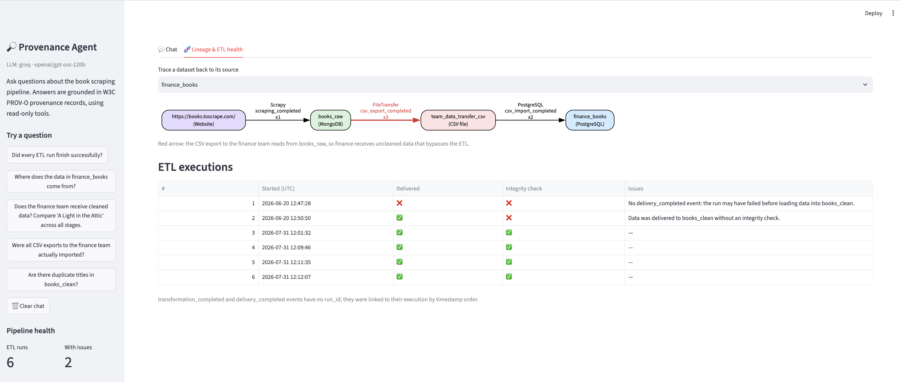
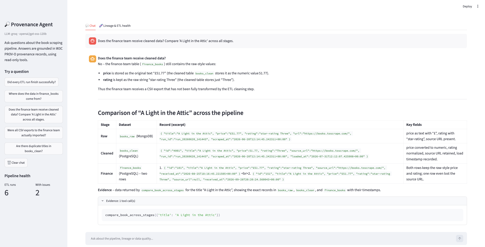
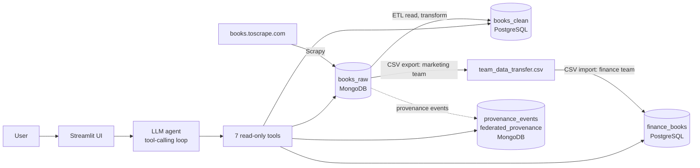

# Provenance Agent

An AI agent that answers questions about a web-scraping data pipeline by reading its **W3C PROV-O provenance records**: where data came from, what happened to it, and where data quality or governance broke down.

Built on top of my master's thesis, *"Data Provenance Systems for Enterprise Web Scraping Pipelines"* (University of Bamberg, 2026).



## What it does

Ask questions in plain language. The agent calls read-only tools against MongoDB and PostgreSQL, and every answer cites its evidence (dataset, run_id, event, timestamp).

| Question | What the agent finds |
|---|---|
| *Did every ETL run finish successfully?* | 6 runs; 1 never delivered its data, 1 loaded data without an integrity check |
| *Does the finance team receive cleaned data?* | No: their CSV export reads from `books_raw`, bypassing the ETL, so prices arrive as `£51.77` text instead of numeric `51.77` |
| *Were all CSV exports actually imported?* | No: 3 exports, but only 2 imports |
| *Are there duplicate titles in books_clean?* | Writes and runs the SQL itself |
| *Delete all rows from books_clean.* | Refuses: all access is read-only |



## Architecture



**Agent loop:** the LLM receives the question and a list of tools, decides which to call, reads the results, calls more if needed, and answers with evidence. Tool results are truncated, and the loop is capped at 8 steps.

**Tools** (`agent/tools.py`):

| Tool | Purpose |
|---|---|
| `describe_data_sources` | Collections/tables, fields and record counts |
| `get_pipeline_events` | Provenance events by run, type or dataset |
| `check_etl_executions` | Groups ETL events into executions and flags incomplete or unchecked runs |
| `trace_lineage` | Walks the provenance graph upstream to the original source |
| `query_postgres` | One `SELECT` query, validated and run on a read-only connection |
| `compare_book_across_stages` | One record in raw, clean and finance stages |
| `get_team_transfers` | Data handovers between teams |

## Design decisions

- **Read-only by design.** PostgreSQL sessions are opened read-only, SQL is restricted to a single `SELECT`, and the agent is instructed to refuse changes. Three layers, so one failure doesn't allow writes.
- **Grounded answers.** The system prompt forbids answering from memory; every fact must come from a tool result.
- **Swappable LLM backend.** One OpenAI-compatible client works with a free cloud API (Groq) or a fully local model (Ollama), selected in `.env`.
- **Lineage normalisation.** The two provenance collections used different names for the same dataset (`books_raw` vs `books_raw_mongodb`); a small alias map reconnects the graph.

## Evaluation

`evals/questions.json` holds 16 hand-written test questions covering ETL health, lineage, SQL, team handovers, a refused delete request, and an out-of-scope question. `evals/run_evals.py` checks whether the agent used the expected tool and whether its answer contains the key facts.

**Result: 16/16** with `openai/gpt-oss-120b` via Groq.

Limitations: the test set is small, and answers are checked for key facts rather than judged in full.

## Tech stack

Python · Scrapy · MongoDB · PostgreSQL · W3C PROV-O · OpenAI-compatible LLM API (Groq / Ollama) · Streamlit · Graphviz

## Run it locally

**Requirements:** Python 3.11+, MongoDB and PostgreSQL running locally with the `thesis_db` data, and a free [Groq](https://console.groq.com) API key (or [Ollama](https://ollama.com) for a local model).

```bash
git clone https://github.com/shreyarn88/Provenance-Agent.git
cd provenance-agent
python3 -m venv venv && source venv/bin/activate
pip install -r requirements.txt
```

Create a `.env` file in the project root:

```
LLM_PROVIDER=groq
GROQ_API_KEY=your_key
LLM_MODEL=openai/gpt-oss-120b
PG_PASSWORD=your_postgres_password
```

Then:

```bash
python -m agent.test_tools          # test the tools without an LLM
python -m agent.agent               # chat in the terminal
streamlit run app/streamlit_app.py  # web UI
python -m evals.run_evals           # run the evaluation
```

## Project structure

```
agent/      tools, agent loop
app/        Streamlit web UI
evals/      test questions and scoring script
pipeline/   thesis pipeline: Scrapy spider, ETL, lineage store
docs/       screenshots
```

## Known limitations and next steps

- ETL transformation and delivery events have no `run_id`, so they are linked to their execution by timestamp order. Next: add an `execution_id` to every pipeline event.
- With the Groq backend, questions and tool results are sent to a cloud API. Use Ollama to keep everything local.
- Next: a larger evaluation set, and an LLM-as-judge for full-answer scoring.

## Author

Shreya Ramanna Narayanamma · [LinkedIn](https://www.linkedin.com/in/shreya-ramanna-n-0b6393172/)
